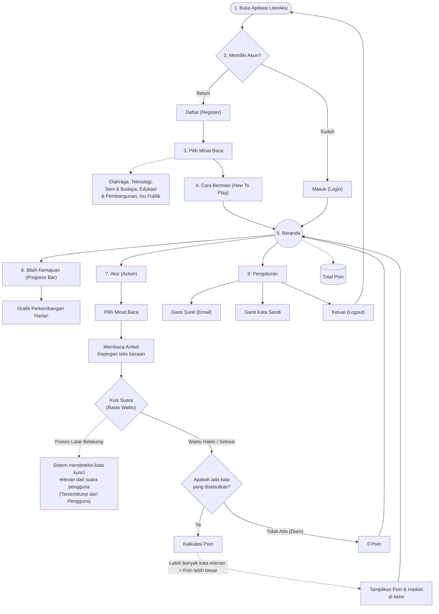

📚 LiterAksi — Platform Literasi & Kuis Suara Interaktif
 
LiterAksi adalah platform web literasi interaktif yang dirancang untuk meningkatkan minat baca sekaligus melatih kemampuan menceritakan kembali (retelling) isi bacaan menggunakan teknologi pengenalan suara (Voice Quiz).
Melalui pendekatan gamifikasi seperti Reward Points, Daily Streak, dan Progress Chart, LiterAksi menghadirkan pengalaman membaca yang menyenangkan, ramah pengguna, dan interaktif.

🌟 Fitur Utama
🔐 Autentikasi & Registrasi Pengguna: Sistem pendaftaran akun lengkap dengan pemetaan minat baca awal dan panduan How To Play.
🎯 5 Topik Minat Baca:
🚀 Teknologi
⚽ Olahraga
🎨 Seni & Budaya
📚 Edukasi & Pembangunan
🌍 Isu Publik
🎙️ Kuis Suara Interaktif (Voice Quiz): Memanfaatkan Web Speech API untuk merekam ucapan pengguna secara langsung (real-time).
🧠 Background Keyword Processing: Sistem mendeteksi dan memproses kata kunci relevan dari suara pengguna secara tersembunyi di latar belakang untuk mengkalkulasi poin akhir.
📊 Bilah Kemajuan (Progress Bar): Visualisasi grafik perkembangan poin harian dan akumulasi mingguan menggunakan Recharts.
🔤 Penyesuaian Ukuran Teks: Fitur Text Resizer (A-, A, A+) pada halaman artikel agar nyaman dibaca.
⚙️ Pengaturan Profil: Pengelolaan akun, perubahan avatar, dan opsi kata sandi.

🗺️ Alur Diagram Alir (User Journey)
Aplikasi ini dibangun berdasarkan alur perjalanan pengguna (user journey) berikut:

💻 Teknologi yang Digunakan
Kategori
Teknologi / Library
Frontend Framework
React.js (JSX)
Styling
Tailwind CSS
Icons
Lucide React
Data Visualization
Recharts
Voice Processing
Web Speech API (webkitSpeechRecognition)

🚀 Cara Menjalankan Proyek (Setup & Installation)
Prasyarat
Pastikan Anda sudah menginstal Node.js (minimal v16+) dan npm / yarn di komputer Anda.
Langkah-Langkah
Clone Repositori ini:
git clone https://github.com/USERNAME_ANDA/flowchart-LiterAksi.git
cd flowchart-LiterAksi
Install Dependensi:
npm install
Jalankan Server Pengembang (Development Server):
npm run dev
Buka peramban (browser) Anda dan akses tautan lokal:
http://localhost:5173

📜 Lisensi
Proyek ini dilindungi di bawah lisensi MIT. Silakan gunakan, modifikasi, dan kembangkan secara bebas untuk kepentingan pembelajaran atau pengembangan lebih lanjut.
